# AstroLynx RAG Architecture

This document describes the code that is currently implemented in AstroLynx. It separates the online question answering path from the offline document preparation and MOSDAC crawling tools. It is a code-oriented map for the next developer, not a claim that every planned ingestion feature is already connected to production.

## At a glance

AstroLynx is a TypeScript monorepo with a Next.js frontend and an Express API. The API uses a LangGraph workflow for routing, retrieval, context assembly, answer generation, and optional speech generation. MongoDB stores accounts, revocable login sessions, conversation metadata, and messages. Pinecone serves the existing dense vector index, Ollama generates query embeddings, and an optional local JSON BM25 sidecar can supplement dense retrieval.

```mermaid
flowchart LR
  User[User in Next.js chat] -->|login cookie, message, sessionId, optional image| API[Express API]
  API --> Auth[Authenticate user and verify conversation owner]
  Auth --> Validate[Validate request]
  Validate --> Init[Lazy initialize services if needed]
  Init --> History[Load bounded MongoDB history]
  History --> Graph[Invoke LangGraph]
  Graph --> Classify{Classify question}
  Classify -->|Greeting| Simple[Localized deterministic reply]
  Classify -->|Other question| Transform[Anchor clear follow-up]
  Transform --> Retrieve[Dense and optional BM25 retrieval]
  Retrieve --> Fuse[Reciprocal rank fusion and deduplication]
  Fuse --> Pack[Quality-filter and pack evidence]
  Pack --> Answer[Gemini answer with evidence rules]
  Answer --> ValidateCites[Validate and retain cited answer units]
  Simple --> Audio{Audio mode?}
  ValidateCites --> Audio
  Audio -->|Yes| TTS[Generate optional speech]
  Audio -->|No| Finish[Return answer]
  TTS --> Finish
  Finish --> Persist[Persist user and assistant messages in MongoDB]
  Persist --> API
  API --> User
```

## Online request workflow

### 1. Frontend creates or restores a conversation

`astrolynx-chatbot Frontend/components/chat-interface.tsx` first calls `GET /api/auth/me` using credentials. A signed-in user can see the chat UI; otherwise the login/sign-up panel is shown. The API issues an opaque, random, 30-day token in an HttpOnly, SameSite=Lax cookie. Only a SHA-256 token hash is stored in the `astrolynx_auth_sessions` Mongo collection; expired rows are removed by a TTL index. User accounts and salted scrypt password hashes live in `astrolynx_users`, with a unique normalized-email index. The auth API includes login throttling, origin checks on state-changing routes, and server-side session revocation on logout.

The active conversation UUID is stored in `localStorage` under `chatSessionId`, but the API verifies that it belongs to the signed-in user before accepting a chat request or returning history. New chats are created with `POST /api/session`; `GET /api/session` lists the user's recent conversations and accepts `?q=` to search titles. The fixed responsive sidebar lets the user select history, start a new chat, search by title, and sign out.

### 2. API validates and dispatches the message

`Backend/src/Controllers/chatController.ts` accepts authenticated `POST /api/chat` requests (and the legacy `/api/chat/image` path). The route authenticates the cookie and checks that `sessionId` is owned by the current user. Zod validates the message length, session UUID, optional PNG/JPEG/WebP data URL, audio-mode flag, and response language. A message or image is required. The controller creates an abort signal so a disconnected browser request can cancel downstream work.

`Backend/src/index.ts` sets CORS, JSON body limits, rate limits, and `/healthz`. The chat service initializes lazily on the first real chat request. Initialization connects MongoDB, creates the Gemini chat model and cached Ollama embedding client, checks the configured Pinecone dense index and vector dimension, builds the vector-store adapter, then compiles the LangGraph.

### 3. MongoDB loads bounded conversation history

`Backend/src/Services/main.ts` loads history for the supplied `sessionId` before invoking the graph. `Backend/src/Services/Memory.ts` uses `BufferWindowMemory` over a custom Mongo history implementation:

- Legacy messages can be read from the configured session collection's `messages` array.
- New messages are appended to the separate messages collection with a timestamp.
- A turn's LLM history is bounded to the newest complete turns, up to 10 message pairs and approximately 12,000 characters.
- The history API returns at most 100 messages and caps individual message text at 16,000 characters.

Conversation history is used to resolve follow-up wording. The answer prompt explicitly says history is not evidence and must not supply current-turn facts or old source IDs. Ownership metadata is stored on conversation documents in the configured session collection; appended messages are scoped by the server after ownership has been checked.

### Conversation titles

Each newly created conversation starts with the title `New chat`. After its first successful answer, the API immediately saves a readable title derived from the first question, returns the chat response, and starts title refinement in the background with the smaller model configured by `GEMINI_TITLE_MODEL` (default `gemini-3.5-flash-lite`). The title prompt asks for 2–6 words in the user's language and prohibits answering the question. If title generation fails, the question-derived title remains. The UI refreshes its conversation list after a turn so the generated title appears when available.

### 4. LangGraph routes the question

The graph is defined in `Backend/src/Services/LangGraphChain.ts`.

- `classifyQuery` is deterministic. It recognizes exact supported-language greetings and routes those to `handleSimpleResponse` without embeddings or retrieval.
- Other questions are classified as MOSDAC questions and routed through retrieval. There is no general intent classifier or LLM-based router in this path.
- If audio mode is requested, the completed text answer goes to `generateAudio`; otherwise the graph ends after answering.

### 5. Query transformation handles explicit follow-ups

`queryTransformation` in `Backend/src/Services/Retrival.ts` detects a list of clear follow-up forms in English, Hindi, Devanagari, Hinglish, Spanish, French, and German. If the current question matches, it prefixes the previous user question to preserve its subject. Otherwise the original question is used.

Despite the function's broad name, the current path does not call an LLM to rewrite queries and does not generate a hypothetical answer/document (HyDE). It currently produces one query variant for ordinary questions. The retrieval layer has a hard cap of three variants if variants are added later.

### 6. Dense and optional lexical retrieval run concurrently

`parallelRetrieval` runs dense and lexical searches concurrently for each query variant.

**Dense retrieval:** `CachedOllamaEmbeddings` in `Backend/src/Services/cachedEmbeddings.ts` uses `nomic-embed-text` through Ollama. It caches exact query vectors for five minutes, coalesces concurrent identical embedding requests, and checks returned vector dimensions against the Pinecone index. The configured Pinecone vector store fetches up to 40 dense candidates. Retrieval drops candidates without traceable source metadata or whose text fails the `usable` extraction-quality gate, then returns up to eight. Dense result caching is an in-process 30-second LRU with up to 64 entries and per-result character limits.

**Lexical retrieval:** if `MOSDAC_LEXICAL_INDEX_PATH` is set, `loadMosdacBm25Index` loads a bounded, validated JSON sidecar once per process. BM25 tokenization preserves Unicode letters and combining marks, which matters for Indic text. The search returns up to eight readable, traceable chunks from its top 20. If the path is unset, lexical retrieval is disabled and the RAG path is dense-only. A malformed configured index is reported as a retrieval-source failure.

Both paths use a `Document` with chunk text and metadata. Dense retrieval is the only always-configured source. The current BM25 sidecar is optional and local to the API host.

### 7. Reciprocal-rank fusion de-duplicates candidates

`rrfReRanking` passes dense and lexical ranked lists to `reciprocalRankFusion`. RRF uses `k = 60`; it combines relative rank contributions rather than comparing raw Pinecone similarity scores with BM25 scores. Candidate identity is based on source, page, and content hash when possible, with chunk IDs as fallback. Duplicate copies from the two stores contribute once per individual ranked list.

This step is rank fusion, not a neural cross-encoder reranker and not an entailment or answer-quality evaluator.

### 8. Evidence is screened, labeled, and packed

`buildContext` in `Backend/src/Services/Memory.ts` takes at most six ranked documents with non-trivial text. It constructs source IDs (`S1`, `S2`, …) from this turn's selected evidence, extracts title/source/page/section metadata, and only accepts an outbound citation URL when it is HTTPS on an allowed MOSDAC host.

Each passage is marked as untrusted source data and JSON-escaped in the prompt. A passage is capped at 5,000 characters. The context token budget is 4,000 tokens, counted with the chat model when available; binary search finds the largest ranked prefix that fits. The same selected passages create the citation metadata, so evidence IDs refer to this turn's context.

The retrieval quality gate uses `assessExtractedText` from `Backend/src/ingestion/textQuality.ts`. Its Unicode-aware heuristic looks for empty/short text, replacement glyphs, controls, private-use glyphs, symbol-heavy output, low word-like token density, repeated lines, and long repeated characters. Its thresholds are provisional heuristics, not calibrated probabilities. The online gate accepts only `usable` passages; pages needing review are not promoted to answers by the online gate.

### 9. Gemini generates and validates an answer

`invokeLLM` in `Backend/src/Services/ChatWithLLM.ts` receives the current evidence context, the current question, bounded conversation history, and optionally a user image. It uses a trusted system message to tell Gemini that source text and chat history are untrusted data, that history is not evidence, and that MOSDAC claims require current-turn source IDs.

The validator then:

1. Rejects citation IDs that were not supplied in the current evidence set.
2. Keeps cited prose paragraphs and individually cited Markdown list items, pruning uncited factual units.
3. Uses a localized abstention response if document evidence exists but no valid cited answer remains.
4. For image turns, preserves the complete generated answer without document citations when no document citation was produced; visible image content can support that answer.
5. Allows image-only descriptions without document citations. Image-derived content is not a MOSDAC source citation.

The citation checks establish marker presence and allowed IDs; they do not prove that a cited passage entails each claim. The model prompt and checks improve grounding discipline but are not a formal semantic verifier.

The user-facing chat currently hides `[S#]` markers and source lists because the active corpus has local-file provenance rather than useful MOSDAC links. The API still carries citation metadata internally for grounding and possible future display.

### 10. Optional speech and history persistence

For audio mode, the graph sends the final text to `convertTextToSpeech`. Speech failures are logged and do not discard the text answer. `main.ts` strips internal source markers, persists the user's question and assistant answer through Mongo history, and returns the assistant message and optional audio data.

## Offline document and crawler workflows

The offline tools prepare data and inspect crawl results; they are not currently one automatic “crawl → parse → embed → Pinecone” pipeline.

```mermaid
flowchart TD
  subgraph PDF[Local PDF quality and lexical preparation]
    PDFs[PDF files in downloaded_docs or mosac-data] --> Extract[Extract capped pages with pdf-parse]
    Extract --> Quality[Assess each page with page-text-quality-v2]
    Quality --> Inspect[inspect-pdf / inspect-corpus reports]
    Quality --> Plan[Plan page-scoped chunks from usable pages]
    Plan --> Human[Review chunk-plan JSON]
    Human --> Sidecar[Build bounded BM25 JSON sidecar]
    Sidecar -. optional runtime path .-> Retrieval[Online lexical retrieval]
  end
  subgraph Crawl[MOSDAC discovery and capture]
    Seeds[Configured or supplied MOSDAC seed URLs] --> CrawlTool[Bounded crawl CLI]
    CrawlTool --> Policy[Robots, same-host redirects, URL policy, caps]
    Policy --> Fetch[Static HTTP; optional bounded browser rendering]
    Fetch --> ExtractHtml[Extract page/catalog/feed records]
    ExtractHtml --> Local[Persist resumable crawl records locally]
  end
```

### PDF workflow

1. `extractPdfPages` checks the file signature and byte limit, hashes the PDF, and extracts pages with `pdf-parse`. It does not OCR, embed, or write an index.
2. `inspect-pdf` and `inspect-corpus` report page text-quality results and optionally bounded samples. The corpus inspector can sample first/middle/last page positions, with a traversal cap.
3. `plan-pdf-chunks` makes a reviewable dry-run chunk plan from pages marked usable. It assigns stable SHA-256 source/chunk IDs, retains page/title metadata, and applies per-file and corpus page/byte/token limits. The output explicitly says no embeddings or index writes occurred.
4. A human reviews that plan. `ingest:build-lexical` validates the plan and emits a bounded JSON BM25 sidecar. This builder does not call Ollama, Gemini, or Pinecone.
5. `rag:evaluate-lexical` can compare BM25 rankings to a supplied human-labeled query set. Its results cover lexical retrieval only.

The deployed dense Pinecone index is legacy data. This codebase does not yet provide the corresponding reviewed PDF-plan-to-dense-embedding/Pinecone ingestion command. Do not infer that new local PDFs or crawler output are automatically in the dense index.

### MOSDAC crawler workflow

`ingest:crawl-mosdac` runs `Backend/src/ingestion/mosdacCrawler.ts`. It supports a no-network dry run by default; `--execute` enables fetching. The crawler uses bounded requests/depth, politeness delays, URL canonicalization and allowed-host policy, robots checks, redirect checks, optional bounded Playwright rendering, crawl-state locks, and local resumable output. Catalog/feed extraction and feed-entry persistence have dedicated modules.

Crawl output is saved as local records. The crawler is not currently wired to PDF quality assessment, chunk planning, embedding, the BM25 builder, or Pinecone writes. Review and ingestion are separate explicit steps.

## Current performance characteristics

- Greeting turns bypass embedding, vector search, and answer generation.
- Repeated exact query embeddings are cached for five minutes; same-process concurrent duplicates share one embedding request.
- Dense retrieval result caching lasts 30 seconds, and identical in-flight lookups are coalesced.
- Dense and configured BM25 lookups run concurrently.
- RRF combines ranked lists without an additional model call.
- Context packing uses a six-document cap and a binary-search token-budget check.
- Normal MOSDAC questions still call the answer model. No answer cache, semantic cache, batch retrieval, learned reranker, query decomposition model, or end-to-end latency target is currently implemented.

## Main code map

| Concern | Main files |
| --- | --- |
| HTTP server and chat API | `Backend/src/index.ts`, `Backend/src/Controllers/chatController.ts`, `Backend/src/Routes/chatRoute.ts` |
| Account login and cookie sessions | `Backend/src/Services/auth.ts`, `Backend/src/Routes/authRoutes.ts` |
| Conversation list, search, and owner checks | `Backend/src/Controllers/sessionController.ts`, `Backend/src/Routes/sessionRoutes.ts` |
| Background title generation | `Backend/src/Services/conversationTitles.ts`, `GEMINI_TITLE_MODEL` in `Backend/src/config/env.ts` |
| LangGraph nodes and routing | `Backend/src/Services/LangGraphChain.ts` |
| Retrieval, follow-up handling, RRF | `Backend/src/Services/Retrival.ts` |
| Query embedding and cache | `Backend/src/Services/cachedEmbeddings.ts` |
| Evidence packing and Mongo history | `Backend/src/Services/Memory.ts`, `Backend/src/Services/main.ts` |
| Prompt, generation, citation checks | `Backend/src/Services/ChatWithLLM.ts` |
| Startup and Pinecone validation | `Backend/src/Services/initializeChatService.ts` |
| PDF extraction and quality | `Backend/src/ingestion/pdfPages.ts`, `Backend/src/ingestion/textQuality.ts` |
| PDF planning and BM25 sidecar | `Backend/src/ingestion/planPdfChunks.ts`, `Backend/src/ingestion/lexicalIndex.ts`, `Backend/src/ingestion/buildLexicalIndex.ts` |
| MOSDAC crawler and extractors | `Backend/src/ingestion/mosdacCrawler.ts`, `Backend/src/ingestion/htmlExtractor.ts`, `Backend/src/ingestion/mosdacCatalog.ts` |
| Chat UI and browser session state | `astrolynx-chatbot Frontend/components/chat-interface.tsx` |

## Known gaps and boundaries

- Existing anonymous conversations have no account owner and are not automatically assigned to the first account that logs in. New conversations are account-scoped. A session ID remains an identifier, not an authentication credential.
- The active dense index may contain old low-quality text. Query-time screening suppresses suspicious passages but cannot repair the source corpus or establish completeness.
- The quality thresholds have not been calibrated against a reviewed MOSDAC page set.
- BM25 remains disabled unless a sidecar is built and `MOSDAC_LEXICAL_INDEX_PATH` is set.
- Crawler output is not indexed automatically, and there is no new dense ingestion path in the current implementation.
- No citation-entailment checker or independently reviewed answer gold set is available; the provisional lexical evaluator is not an answer-quality benchmark.
- User-visible citations are hidden until sources can be presented with useful, stable MOSDAC provenance.
- Email verification, password reset, account deletion, and migration/claiming of older anonymous conversations are not implemented.
